## 한눈에 보기

PE LOG는 체육 수업에 필요한 일을 **메뉴 6개**에 모았어요. 휴대폰은 아래 탭, PC는 위쪽 메뉴와 왼쪽 하위 메뉴로 움직여요.

| 메뉴 | 이런 일을 해요 |
| --- | --- |
| **홈** | 오늘 수업 · 이번 주 시간표 · 날씨와 미세먼지 · 기초 설정 |
| **수업** | 수업반 기록표(칭찬 · 지도 · 출결) · 종목 수업자료 · 보조심판 · 타이머 · 팀 나누기 |
| **PAPS** | 기록 입력 → 자동 등급 → 통계 → 나이스 업로드 파일 |
| **평가** | 수행평가 채점 · 기록지 · 나이스 파일, 세특 쓰기 |
| **업무** | 학교운동부 · 스포츠클럽 나이스 업무, 체육 예산, 같은 학교 선생님과 같이 쓰기 |
| **설정** | 학교 정보 · PIN · 백업 · 사용법 |

> 먼저 써 보고 싶다면 주소 끝에 `?demo=1`을 붙인 **시연 모드**로 여세요. 가상 학생으로 모든 기능을 눌러 볼 수 있고, 실제 자료와는 완전히 따로예요.

## 처음 시작하기

1. 휴대폰에서 앱 주소를 열고 **홈 화면에 추가**를 누르면 앱처럼 쓸 수 있어요. 아이폰은 꼭 추가해 주세요.
2. 4~6자리 **PIN**을 정해요. 앱을 열 때마다 물어봐서 폰을 잃어버려도 학생 정보를 지켜요.
3. **홈 → 기초 설정**을 위에서부터 따라 해요: 명렬 올리기 → 수업반 만들기 → 내 시간표(나이스 · 컴시간에서 불러오기 가능).
4. 평가계획서 PDF가 있으면 **홈 → 평가계획서 넣기**로 진도표 초안과 수행평가를 한 번에 만들어요.

## 홈

- 시간표대로 **지금 수업 · 오늘 수업**이 떠요. 누르면 그 반 기록 화면으로 바로 가요.
- **날씨 카드**: 지금 기온 · 강수확률과 미세먼지 · 초미세먼지 등급(에어코리아)을 보여 주고, 나쁨 이상 · 비 · 폭염 · 한파면 실외 수업 주의를 알려 줘요. 학교 위치는 나이스 학교 주소로 자동으로 정해지고, 시도 · 시군구로 직접 골라도 돼요.
- **이번 주 수업 카드**: 칭찬 · 지도 · 견학 · 결석을 지난주 같은 때와 비교해요. 누르면 지도가 쌓이는 학생, 칭찬을 아직 못 받은 학생, 늦은 진도, 덜 끝난 채점이 모여 있어요(학생 이름은 이 화면에서만).
- 오른쪽 아래 **땅콩이**에게 "명렬은 어떻게 올려?"처럼 물어보면 사용법과 바로가기를 알려 줘요.

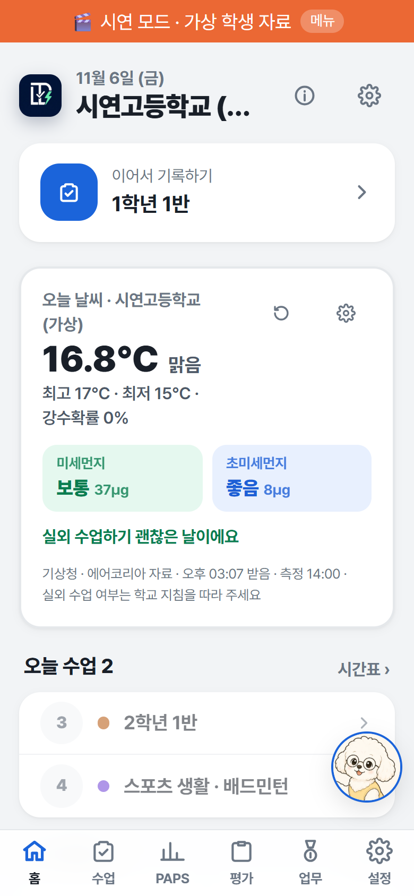

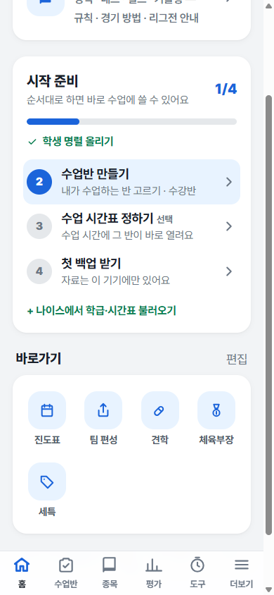

## 수업

### 기록표 — 나이스처럼 한 장에

수업반을 열면 **기록표**가 먼저 나와요. 왼쪽은 학생, 위는 이 달의 수업 날짜예요.

1. 위 입력 칸에서 **★칭찬 항목**(정리정돈 · 친구 도움 …), **▲지도 항목**(체육복 · 실내화 …), **출결**(결석 · 지각 · 조퇴 · 결과) 중 하나를 고르고
2. 학생 × 날짜 칸을 누르면 바로 기록돼요. 다시 누르면 빠져요.
3. 아무것도 고르지 않고 칸을 누르면 그날 기록 창이 열려요.

오른쪽 끝에는 이 달 합계가 붙고, 결석이 많아 출석률이 부족해질 학생은 이름 옆에 **주의 · 미달**이 떠요.

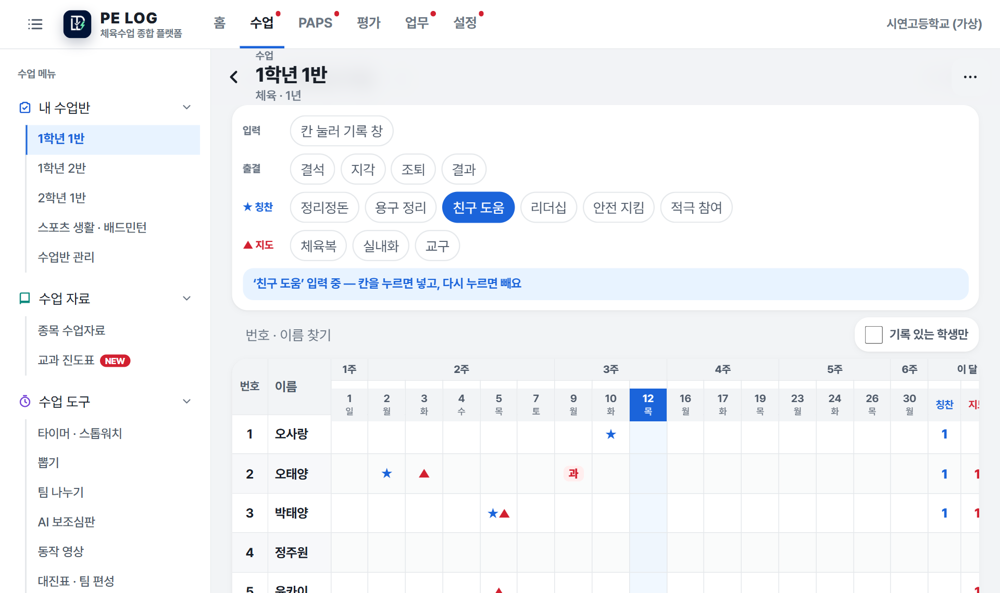

### 카드 · 출결 — 수업 중 한 손으로

- **카드**: 학생을 누르면 왼쪽 칭찬, 오른쪽 지도 버튼이 나와요. 버튼 한 번이면 끝, 5초 안에 되돌릴 수 있어요. 견학 · 관찰 메모 · 세특 키워드도 같은 창에서 남겨요.
- **출결**: 모두 출석에서 시작해요. 안 온 학생 카드를 누를 때마다 결석 → 지각 → 조퇴 → 결과 → 출석으로 바뀌어요. 사유는 [사유 보기]를 눌러야 보여요.

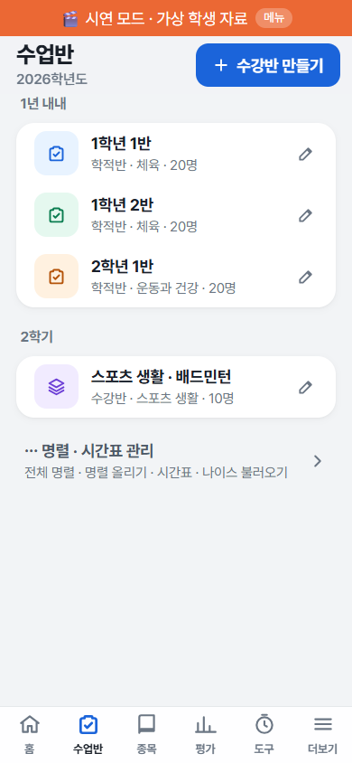

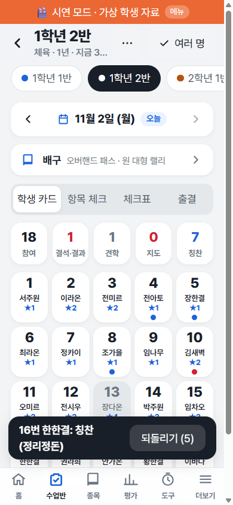

### 종목 수업자료 · 슬라이드

농구 · 넷볼 · 배구 · 배드민턴 · 티볼 · 플라잉디스크 등 **23개 종목**을 영역형 · 네트형 · 필드형 · 기술형으로 나눠 담았어요. 줄마다 공식 규칙서 조항이 붙어 있어요.

- **한 장으로 보는 규칙**: 그 종목 핵심 규칙을 그림 한 장으로. [그림 받기]로 인쇄할 수 있어요.
- **슬라이드로 보기**: 빔에 띄우면 검은 화면에 큰 그림, 누를 때마다 한 줄씩 나와요. 끝에는 O/X 퀴즈. **[PPT로 받기]**로 같은 모양의 발표 파일도 받아요.

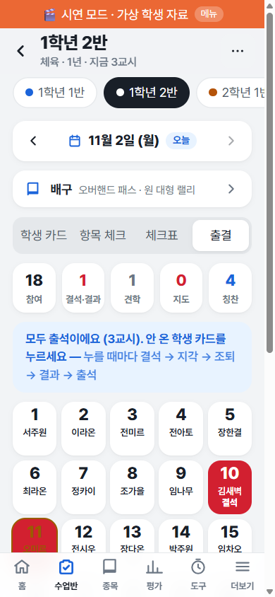

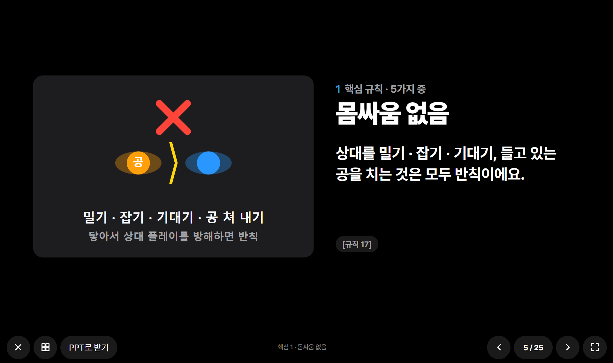

### 보조심판 · 수업 도구

- **보조심판**: 점수 · 경기 시간 · 팀 파울을 한 화면에서. 반칙 버튼을 누르면 판정 · 다시 시작 방법 · 심판 신호 · 학생에게 할 한마디가 크게 떠요. 애매한 상황은 [AI에게 묻기]로 물어볼 수도 있어요(학생 정보는 보내지 않아요).
- **수업 도구**: 타이머 · 스톱워치(랩을 학생 PAPS 기록으로), 뽑기, 팀 나누기(오늘 견학 빼고 · 남녀 고르게), 동작 영상(지연 재생 · 슬로모션), 팀 편성 · 전술 보드 앱으로 명단 보내기.

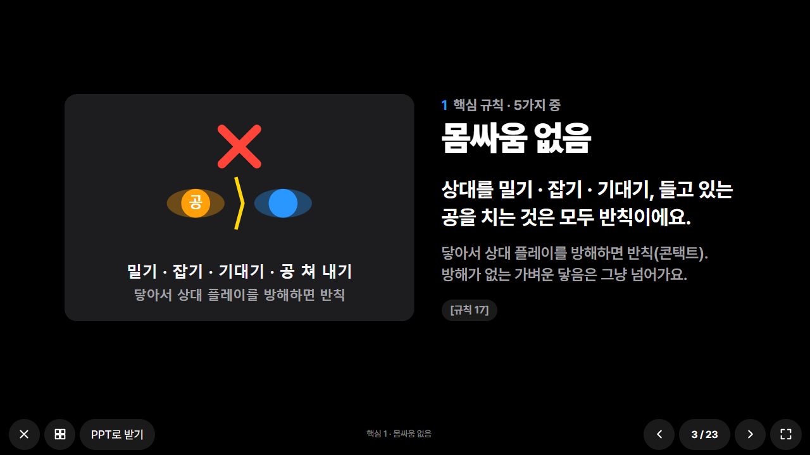

## PAPS

1. **측정 설정**에서 반마다 종목을 골라요. 나이스 양식 머리글을 붙여 넣으면 저절로 맞춰져요.
2. **기록 입력**에 숫자를 넣으면 교육부 공식 기준표로 **등급 · 점수가 바로** 나와요. 엑셀에서 복사해 **붙여넣기 입력**도 돼요.
3. 여러 번 측정하면 **회차**로 나눠 비교하고, **통계 · 그래프**에서 등급 분포 · 요인별 평균 · 변화를 봐요. 1·2등급은 파랑, 3등급은 회색, 4·5등급은 빨강이에요.
4. **건강체력교실**: 운영계획 → 참여 학생(대상 후보 + 희망 학생) → 활동 기록 · 참여 체크 → 다시 측정한 뒤 체력 변화 분석까지 한 화면에서, 엑셀로 받아요.
5. **학교 전체 결과**: 교육청 서식(PAPS 측정결과 · 미측정 학생 관리부)을 채워 받고, 작년 같은 학년과 비교해요. 학급 · 학년별 등급 분포, 저체력 · 비만 학생 수, **건강체력교실 대상 후보 명단**을 한 번에 보고 엑셀로 받아요. 대상 기준(종합 4·5등급 · 경도 · 고도비만)은 학교 지침에 맞게 바꿀 수 있어요.
6. 학생 화면의 **학년별 PAPS 변화**: 지난 학년도 명렬이 이 기기에 남아 있으면 고1 → 고2 → 고3 종합점수를 이어서 보여 줘요.
4. **나이스 파일**: 빈칸 · 범위 오류를 먼저 잡아 업로드 실패를 막아요. 최근 회차 · 최고 회차 · 요인별 최고 중에 골라 받아요.
5. 도구: **왕복오래달리기**(신호 +1과 늦은 학생만 누르면 기록 자동), 윗몸말아올리기 · 스텝검사 신호음.

등급이 나이스 산출값과 다르면 나이스 값이 우선이에요.

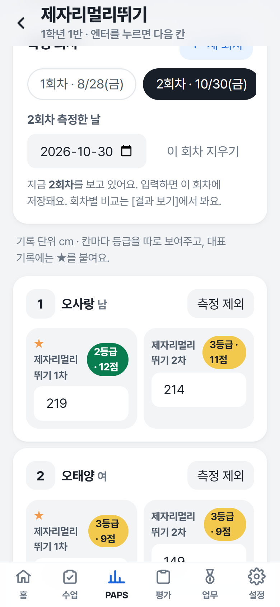

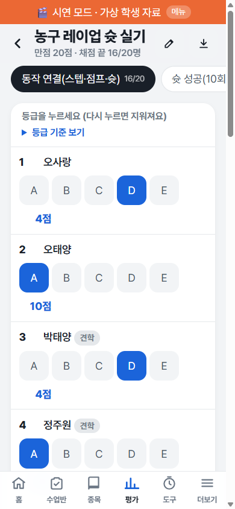

## 평가

### 수행평가

1. **평가계획서로 만들기**(PDF를 넣으면 채점 기준까지), **예시로 만들기**(체크리스트형 · 루브릭형), **루브릭 만들기**(성취기준 → 판단 기준 초안) 중 편한 방법으로 평가를 만들어요.
2. **채점**: 화면 위 **채점 현황**에서 남은 학생 수를 보고 [명단 복사]로 미제출 · 미응시 학생을 알려 줄 수 있어요. 체크리스트는 항목 번호만 누르면 만족 수 → 점수, 백지 제출 · 미응시 · 상중하 수준까지 자동이에요. 구글 시트에서 채점한 표도 그대로 붙여 넣을 수 있어요.
3. 채점 기준과 기록지(빈 기록지도)를 **인쇄 · 엑셀**로, 나이스 일괄입력 파일은 **나이스 파일**에서 받아요.

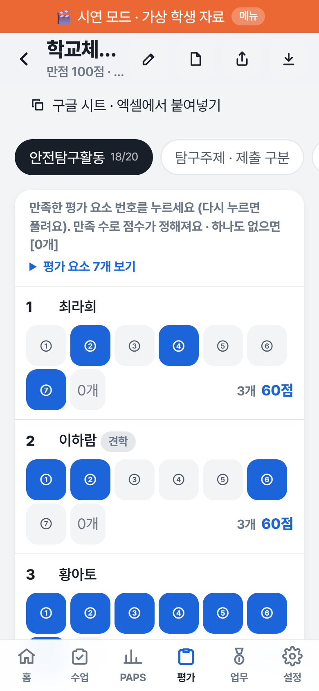

### 세특 쓰기

1. **수준 나누기**: 수행평가 점수 · 칭찬 · 관찰 · PAPS로 반 안에서 3~5수준을 제안해요. 선생님이 고칠 수 있어요.
2. 학생을 누르면 근거 기록이 #1, #2 번호로 보여요. 기록에 없는 내용은 넣지 않아요.
3. **[수준 틀로 초안 넣기]** → 선생님 문장으로 고치기. 1,500바이트와 기재요령 금지어 · 유의어를 바로 검사해요.
4. **설문 · 자기평가**: 구글 설문 응답 시트를 붙여 넣으면 학생마다 답을 맞춰 보관하고, 편집 창에 '학생이 쓴 글(참고만)'으로 보여요. 초안 · AI에는 넣지 않아요(학생 제출 글은 참고만).
5. AI로 다듬을 때는 학생 이름을 가리고 보내요. AI 글을 고치지 않으면 확정할 수 없어요(기재요령 총칙 5-다).

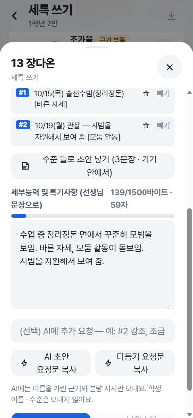

## 업무

- **매년 기안 · 제출 문서**: 기안문 초안에 앱 자료로 현황(여학생 수 · PAPS 결과 · 측정 종목 · 건강체력교실 대상 · 소위원회 위원)을 채워 줘요. 나이스와 따로 매년 학교장 결재로 세워야 하는 계획(여학생 체육활동 활성화 계획, 정규교육과정 외 스포츠클럽 운영 계획, 건강체력교실 운영 계획 등 7가지)을 근거 · 꼭 넣을 내용과 함께 보여 주고 **기안문 초안**을 복사해요. 교육청 제출 일정은 업무 달력에 한 번에 넣어요.
- **학교체육소위원회 회의 · 회의록**: 위원 명단, 1 · 2학기 정기회의(연 2회 의무) 현황, 회의 기록(성원 · 의결 기준 자동 계산), 회의록 인쇄 · 복사.
- **학교체육소위원회**: 설치 근거 · 구성(5~7명, 외부위원 1명 이상) · 학기마다 한 번 회의 · 심의할 일(스포츠클럽 조직, 운동부 창단 · 해체, 최저학력 과목 대체 등) · 운영 규정 예시를 교육청 문서 쪽수와 함께 정리했어요.
- **학교운동부 · 학교스포츠클럽**: 나이스에서 할 일을 메뉴 경로 · 버튼 순서 · 일정 · 규정 · 양식으로 정리했어요. 학교운동부는 [교육] 탭에서 꼭 받아야 하는 교육(법적 의무교육 5가지 등)의 대상 · 횟수 · 근거를, [양식] 탭에서 교육청 제출 서식 · 전지훈련 · 지도자 채용 서류를 볼 수 있어요. 교육청 공문 PDF를 이 기기에 넣어 두면 쪽 표시를 눌러 그 쪽이 앱 안에서 바로 열려요.
- **체육 예산 현황**: 에듀파인 사업관리카드 엑셀을 넣으면 체육 항목만 골라 잔액 · 집행률을 보여 주고, 구글 시트에 붙일 표를 만들어 줘요. 엑셀 없이 직접 입력해도 돼요.
- **같이 쓰기**: 업무 달력, 진도표 · 수행평가 틀 보내기 · 받기(링크 · 파일, 학생 정보 없이), 같은 학교 선생님과 **교구 대여 장부 · 체육관 예약**(학교 공유 공간, 공유 코드 + 비밀번호).

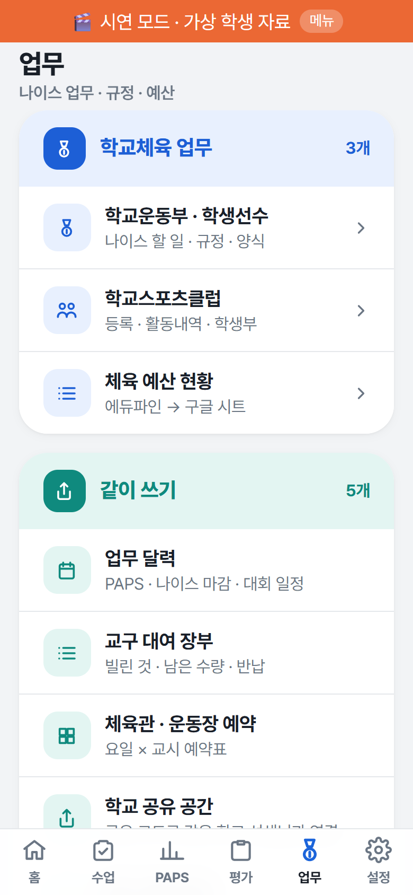

## 설정 · 백업

- 자료는 이 기기 안에만 있어요. **1주일에 한 번 [설정 → 백업]**으로 파일을 받아 두세요. 백업 칸에 마지막 백업 날짜가 보여요.
- 폰을 바꾸면 새 폰에서 **[복원]**으로 백업 파일을 고르면 그대로 돌아와요.
- 쓰지 않는 기능은 **[기능 고르기]**에서 숨겨요. 맡은 일(체육 수업 · PAPS 측정 · 체육부장 운영 · 학교체육 업무)을 고르면 필요한 메뉴만 한 번에 켜져요. 숨겨도 자료는 지워지지 않아요.
- 백업 파일에는 학생 이름이 들어 있어요. 단체방이나 공개된 곳에 올리지 마세요.

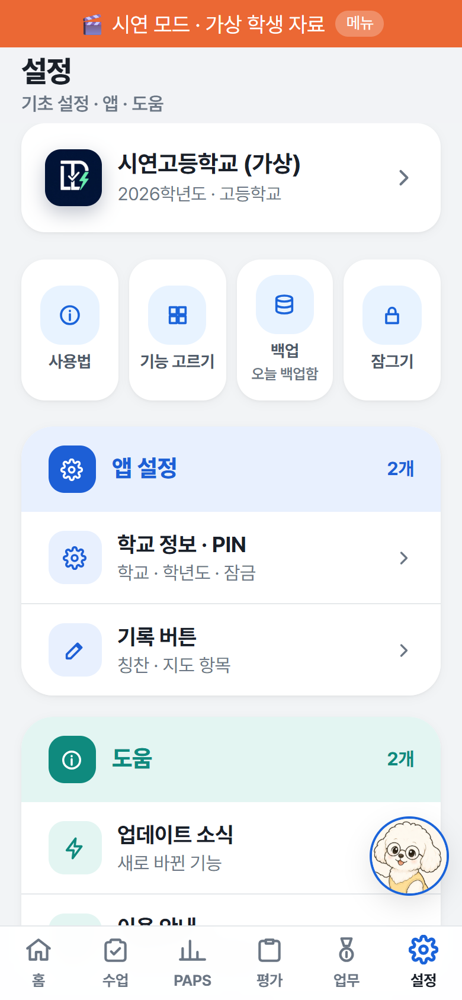

## 자주 묻는 질문

| 질문 | 답 |
| --- | --- |
| 학생 정보가 서버로 가나요? | 아니요. 명렬과 모든 기록은 이 기기의 브라우저 안에만 저장돼요. 날씨 · 시간표 · 공유 공간도 학생 정보는 보내지 않아요. |
| 운동장에서 인터넷이 안 돼도 쓸 수 있나요? | 네. 기록 · PAPS · 채점은 인터넷 없이 동작해요. 날씨 · 시간표 불러오기만 인터넷이 필요해요. |
| 돈이 드나요? | 무료예요. |
| PC와 폰을 같이 쓸 수 있나요? | 기기마다 자료가 따로예요. 백업 파일로 옮기세요. |

---

## 캡처 목록

모든 캡처는 **시연 모드(`?demo=1`, 가상 학생)**에서 찍었어요(2026-11-06, 새 메뉴 기준). 휴대폰 390×844, PC 1280×760.

| 파일명 | 화면 |
| --- | --- |
| manual-01.png | 홈 (휴대폰, 오늘 수업 · 이번 주 수업 카드 · 내 수업반) |
| manual-02.png | 수업 메뉴 (PC, 위 큰 메뉴 + 왼쪽 하위 메뉴 + 색 묶음) |
| manual-03.png | 기록표 (PC, '친구 도움'을 고르고 칸에 기록) |
| manual-04.png | 카드 → 칭찬 · 지도 기록 창 (휴대폰) |
| manual-05.png | 출결 (휴대폰, 결석 · 지각 한 명씩) |
| manual-06.png | 종목 수업자료 · 한 장으로 보는 규칙 (휴대폰, 넷볼) |
| manual-07.png | 슬라이드로 보기 (PC, 넷볼 핵심 규칙) |
| manual-08.png | 보조심판 판정 창 (휴대폰, 농구 트래블링) |
| manual-09.png | PAPS 기록 입력 (휴대폰, 칸마다 등급) |
| manual-10.png | PAPS 통계 (PC, 종합등급 분포 — 1·2등급 파랑 · 3등급 회색 · 4·5등급 빨강, 요인별 평균) |
| manual-11.png | 수행평가 체크리스트 채점 (휴대폰, 위에 채점 현황) |
| manual-12.png | 세특 쓰기 편집 창 (휴대폰, 수준 틀 초안 · 바이트) |
| manual-13.png | 업무 메뉴 (휴대폰, 매년 기안 · 제출 문서 · 학교체육소위원회 · 회의록) |
| manual-14.png | 설정 (휴대폰) |
